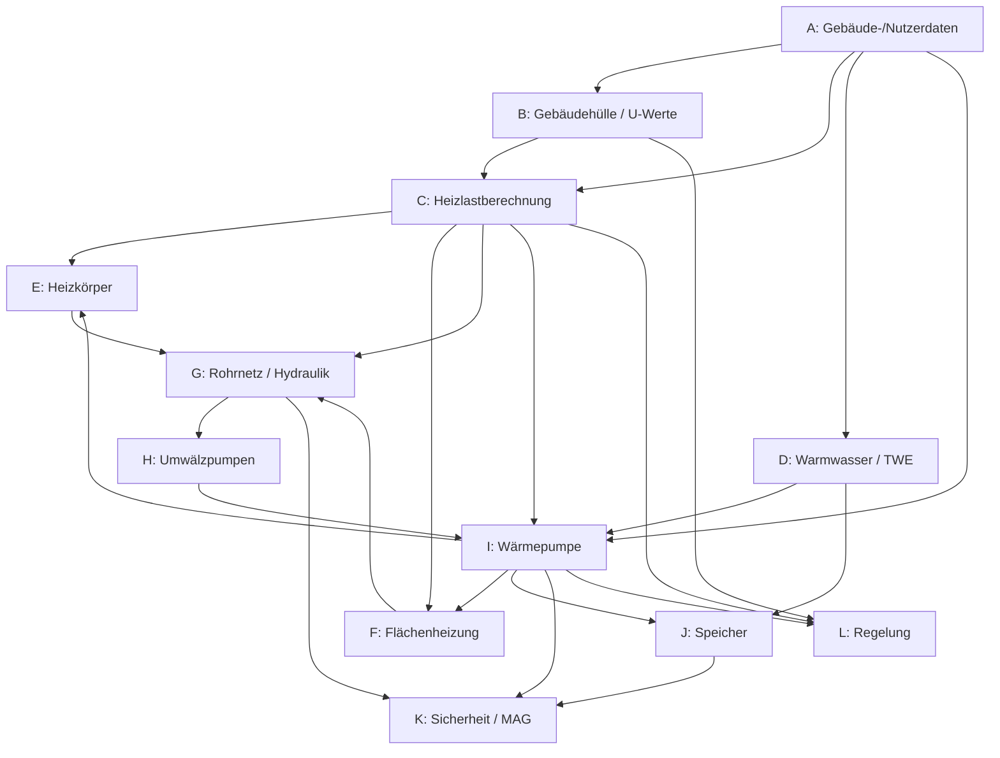

# Wissensbasis WP-Dimensionierungstool

**Zweck:** Strukturierte Wissensdatenbank für den Bau eines interaktiven Wärmepumpen-Dimensionierungstools im Sanierungs-Kontext. Jede Bereichsdatei enthält alle relevanten Formeln, Richtwerte, Prozessschritte und Quellenverweise aus den SHK-Lehrmitteln.

**Quellen-Legende:**
- **B1** = Fachkunde SHK
- **B2** = Technische Mathematik
- **B3** = Formelsammlung
- **B4** = Tabellenbuch SHK
- **B5** = Lösungen Mathematik

**Bereichs-Dateien:**

| # | Bereich | Datei | Status |
|---|---------|-------|--------|
| A | Gebäude-/Nutzerdaten | [A_Gebaeudedaten.md](A_Gebaeudedaten.md) | ✅ |
| B | Gebäudehülle / U-Werte | [B_Gebaeudehuelle_UWerte.md](B_Gebaeudehuelle_UWerte.md) | ✅ |
| C | Heizlastberechnung | [C_Heizlastberechnung.md](C_Heizlastberechnung.md) | ✅ |
| D | Warmwasser / TWE | [D_Warmwasser_TWE.md](D_Warmwasser_TWE.md) | ✅ |
| E | Heizkörper | [E_Heizkoerper.md](E_Heizkoerper.md) | ✅ |
| F | Flächenheizung | [F_Flaechenheizung.md](F_Flaechenheizung.md) | ✅ |
| G | Rohrnetz / Hydraulik | [G_Rohrnetz.md](G_Rohrnetz.md) | ✅ |
| H | Umwälzpumpen | [H_Umwaelzpumpen.md](H_Umwaelzpumpen.md) | ✅ |
| I | Wärmepumpe | [I_Waermepumpe.md](I_Waermepumpe.md) | ✅ |
| J | Speicher | [J_Speicher.md](J_Speicher.md) | ✅ |
| K | Sicherheit / MAG | [K_Sicherheit_MAG.md](K_Sicherheit_MAG.md) | ✅ |
| L | Regelung | [L_Regelung.md](L_Regelung.md) | ✅ |
| M | Förderungen Wärmepumpen (Bund + 7 Kantone) | [M_Foerderungen_Waermepumpen.md](M_Foerderungen_Waermepumpen.md) | ✅ |
| N | Baugesuche & Anmeldungen WP (7 Kantone) | [N_Baugesuche_Waermepumpen.md](N_Baugesuche_Waermepumpen.md) | ✅ |
| 99 | QA-Report | [99_QA_Report.md](99_QA_Report.md) | ✅ |

**Standard-Aufbau jeder Bereichsdatei:**
1. Zweck & Anwendung im Tool
2. Kernformeln (Symbol | Bedeutung | Einheit | Quelle)
3. Tabellen & Richtwerte (Sanierungs-Fallbacks)
4. Exakt-Modus Workflow (mit bekannten Daten)
5. Richtwert-Modus Workflow (Bestand/unbekannt)
6. Plausibilitätsprüfungen
7. Normenverweise
8. Quellenregister

**Verwendungshinweis beim Tool-Bau:**
- Für UI-Defaultwerte → Abschnitt "Tabellen & Richtwerte"
- Für Berechnungen → Abschnitt "Kernformeln"
- Für Fallbacks bei "Unbekannt"-Eingabe → Abschnitt "Richtwert-Modus"
- Für Warnhinweise/Validierung → Abschnitt "Plausibilitätsprüfungen"

---

## Abhängigkeiten zwischen Bereichen

**Datenfluss-Tabelle** (was jeder Bereich als Input braucht und an wen er liefert):

| Bereich | Benötigt als Input | Liefert Outputs an |
|---------|--------------------|--------------------|
| A Gebäude-/Nutzerdaten | — (Basis: Standort, Nutzung, Baujahr) | B, C, D, I |
| B Gebäudehülle / U-Werte | A (θe, θint, Baujahr) | C |
| C Heizlastberechnung | A (θe, θint, n50, e, ε, V), B (U-Werte, Flächen) | E, F, G, I, L |
| D Warmwasser / TWE | A (Personenzahl, Komfortstufe) | I, J |
| E Heizkörper | C (ΦHL,Raum), B (θint,Raum), I (θV/θR) | G |
| F Flächenheizung | C (ΦHL,Raum), I (θV/θR) | G |
| G Rohrnetz / Hydraulik | C (V̇ges), E/F (Heizsystem-Auslegung) | H, K |
| H Umwälzpumpen | G (Δp, V̇) | I (Hilfsenergie-JAZ) |
| I Wärmepumpe | C (ΦHL,geb), D (ΦWW), A (θe, θm,e) | J, K, L |
| J Speicher | I (PWP, Taktverhalten), D (VWW) | K |
| K Sicherheit / MAG | G (VAnlage), I (PWP, θmax), J (VSpeicher) | — |
| L Regelung | I (Gerätetyp), C (Norm-Heizlast), B (Gebäudetyp für Heizkurve) | — |

**Mermaid-Flussdiagramm:**

**Berechnungsreihenfolge für Tool-Build:**

1. **Eingabe-Layer:** A (Stammdaten) → B (Bauteil-U-Werte)
2. **Heizlast-Layer:** C (Raum- & Gebäude-Heizlast)
3. **Bedarfs-Layer:** D (Warmwasserbedarf parallel)
4. **Wärmeübergabe-Layer:** E / F (Heizflächenauslegung)
5. **Verteilung-Layer:** G (Rohrnetz) → H (Pumpe)
6. **Erzeuger-Layer:** I (WP-Auswahl + Bivalenzpunkt)
7. **Peripherie-Layer:** J (Puffer/WW-Speicher) → K (MAG/SV)
8. **Steuerung-Layer:** L (Heizkurve, Regelstrategie)

**Iterative Rückkopplung (zweiter Durchgang nötig, wenn WP-Auswahl Auswirkungen hat):**
- I → E/F: Wenn VLT reduziert werden muss (z. B. 35 °C statt 55 °C), E/F neu dimensionieren
- I → L: Heizkurve an tatsächlichen WP-Modus (monovalent/bivalent) anpassen
- H ↔ I: Hilfsenergie der Pumpe beeinflusst JAZ-Bewertung
